<div align="center">




</div>

## 🎯 The problem

Every month, ward sisters, care-home managers, factory supervisors and call-centre leads spend **days** building the
next roster by hand in a spreadsheet. Everyone has a contract (hours, nights, weekends), nobody may start a day shift
straight after a night, people ask for days off, and every shift needs enough people. Done by hand, rosters **break rest
rules** (single days off between shifts), **feel unfair** (always the same people on nights and weekends) and **fall
apart** when someone calls in sick.

**Shift Roster** builds the whole roster in a minute, keeps **every rule**, grants **as many requests as possible**,
shares nights fairly, shows exactly **where the team is short and what would fix it**, and repairs the roster in
seconds after a sick call, changing as few published shifts as possible.

## ✨ What it does

| Tab | What you get |
|---|---|
| 📥 **Team** | the demo ward, any of the 24 benchmark instances, or your own Excel workbook (shifts, staff and contracts, cover, leave, requests) |
| ⚙️ **Roster** | a roster in a minute with live progress, checked by independent code, compared with filling it by hand |
| 📅 **Calendar** | the roster as a coloured grid (weekends, leave, changes marked), the cover per day, a coloured Excel roster to print |
| ⚖️ **Fairness** | hours inside every contract, nights and weekends per person, requests granted by priority |
| 🤒 **Sick call** | who is away and for how long, or extra cover needed: repaired from today with the fewest changes |
| 🔍 **What would help** | still short? compare one more weekend each, overtime, relaxed runs or one more hire |

## 📸 The app

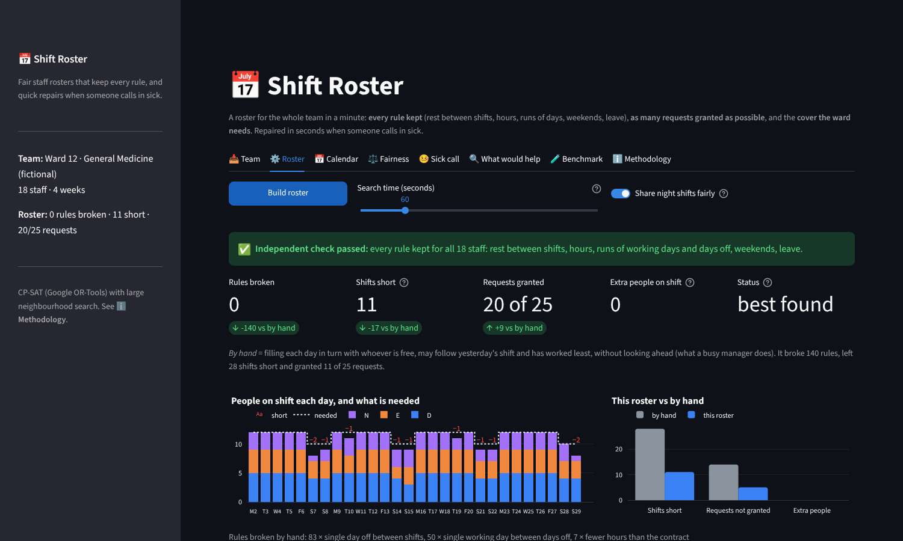

| **The team: cover needed and shift rules** | **The roster vs filling it by hand** |
|:---:|:---:|
| 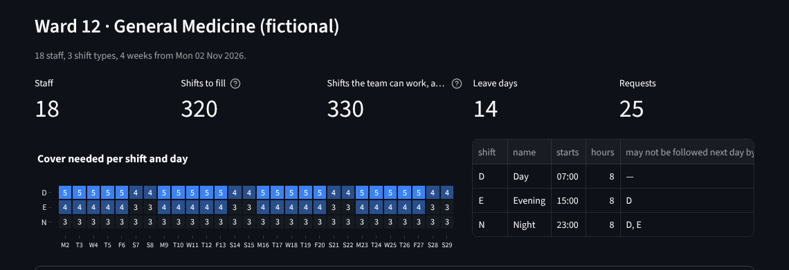 | 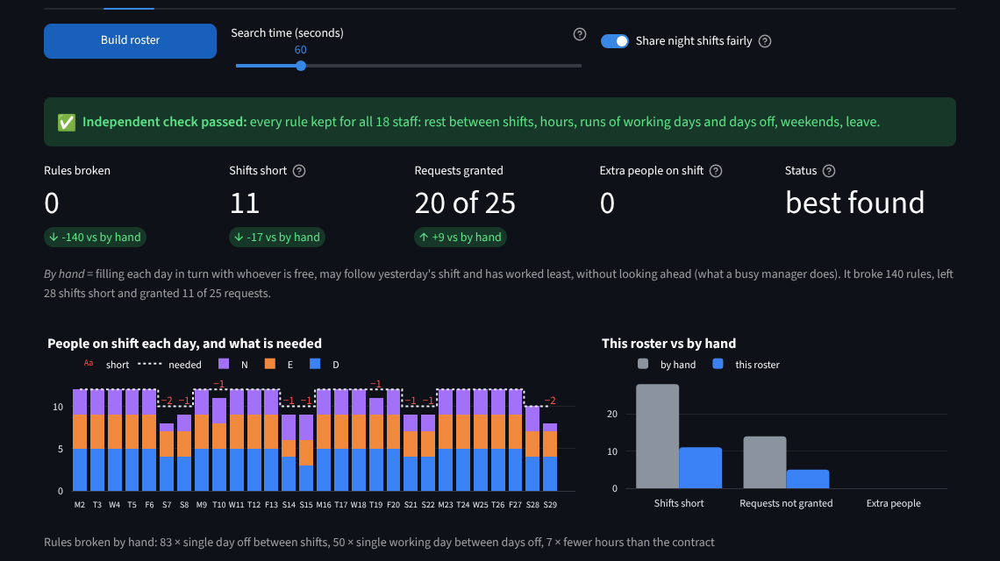 |
| **The calendar** | **Fairness** |
| 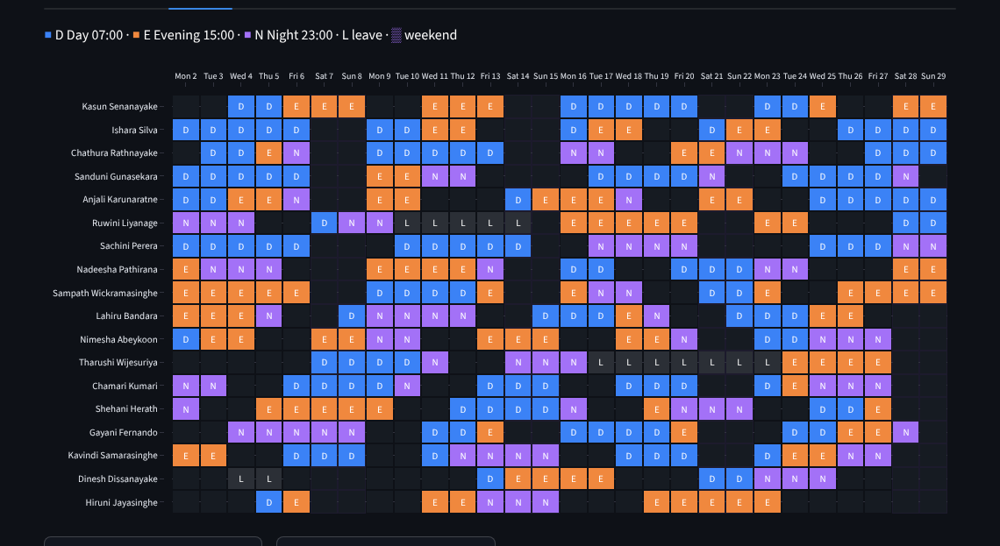 | 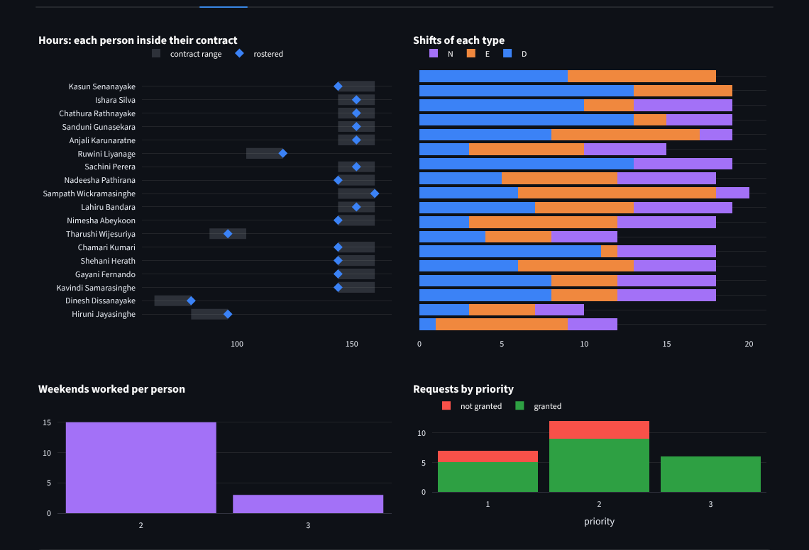 |
| **A sick call, repaired** | **What would fix the shortfall** |
| 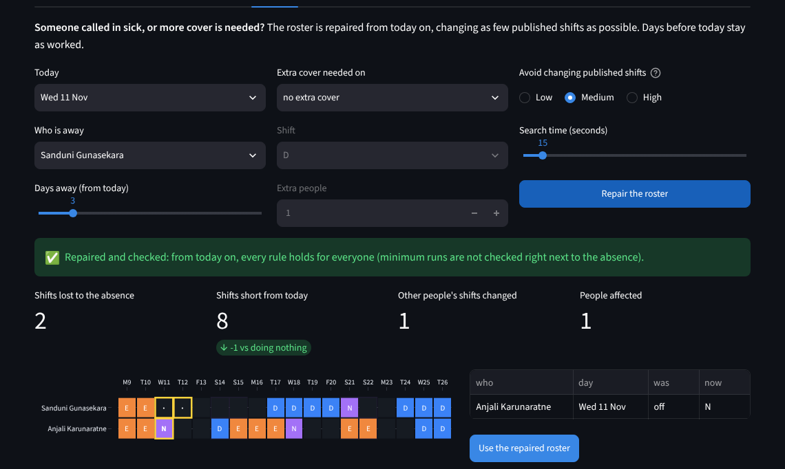 | 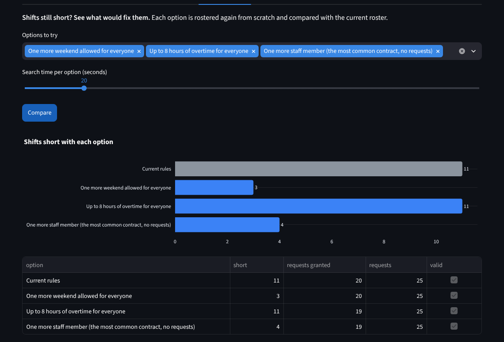 |

## 🤒 Sick calls in seconds


Days already worked never change. Hours, shifts and weekends already worked are taken off each limit, the days away
count towards the contract (nobody makes them up), and every changed shift costs a little, so the repair touches as
few people as possible. The level is yours: **avoid changes** (may leave a shift short) or **fill every gap**.

## 🧪 Benchmark


The [Curtois & Qu (2014)](https://www.schedulingbenchmarks.org/nrp/) instances are the standard test set for nurse
rostering, built from real hospital rules; every best known roster is proven optimal. Instances 1 to 19 (8 to 120 staff,
2 to 12 weeks) were rostered for 5 minutes each on one thread; every roster passed the independent checker.

| Measure | Result |
|---|---|
| Rosters valid | **19 of 19** |
| Best known matched (proven optimal by this app too) | **6** (instances 1 to 6) |
| Within 1% / 3% / 10% of the best known | 9 / 13 / 16 |
| Median gap | **2.0%** (first roster: 105%) |
| Hardest | Instance 13 (120 staff, 18 shift types): 63% above the best known |

Instances 20 to 24 (half a year to a year, 50 to 150 staff) need far more than 5 minutes and are not included.

## 🧠 How it works


| Step | In plain words |
|---|---|
| **Model** | One yes/no per person, day and shift. Hard rules are constraints, soft goals are penalties: 100 per person short, 1 per extra person, a request's priority if not granted, optionally nights above a fair share. |
| **First roster** | Every hard rule belongs to one person, so each person first gets a valid pattern on their own (for tight contracts: as many working days as allowed, stopping once the minimum hours are met). |
| **Whole problem** | Small teams are solved at once by CP-SAT (Google OR-Tools) with its LP relaxation, which often proves the roster optimal. |
| **Neighbourhood search** | Free a part (a few people over a few weeks, many people over a few days, or the people around a short shift), keep everyone else, and let CP-SAT re-roster that part exactly. The size adapts to how fast parts are solved. |
| **Independent check** | Separate code re-checks every rule for every person and recomputes every penalty from the roster. |

## 🚀 Quick start

```bash
git clone https://github.com/harshadulshan/shift-roster.git
cd shift-roster
pip install -r requirements.txt
streamlit run app.py
```

Click **Load the demo**, then **⚙️ Roster → Build roster** (one minute). For your own team, fill in
[`sample_data/roster_template.xlsx`](sample_data/roster_template.xlsx) (the fictional demo ward) and upload it.

## ✅ Verified

```bash
python tests/verify_engine.py       # 45 checks: brute force, published optima, every rule, sick calls, Excel
python tests/verify_app.py          # 17 checks: clicks through every tab, builds, repairs, compares options
python tests/mutation_test.py       # 13 planted bugs, each must be caught
python benchmarks/run_benchmark.py --seconds 300
```

- **Exact on small rosters:** on 18 random rosters solved by brute force (every valid row of every person, every
  combination), the solver always finds the optimum, both as a whole and with neighbourhood search alone.
- **Published optima reproduced:** instances 1 to 6 reach the proven optimal penalties exactly, which also confirms the
  rules are read the way the benchmark means them.
- **Mutation test:** 13 bugs planted one at a time (the checker forgetting rest rules or Sundays, the solver dropping
  the weekend limit or ignoring day-off requests, a sick call rewriting days already worked, ...). All caught.

## ⚠️ Limitations

- Skill mix (e.g. one senior nurse on every shift) is not modelled yet; shift types per grade can approximate it.
- One period at a time; only sick-call repairs carry over what was already worked.
- Large teams over long periods need more time: on 120 staff with 18 shift types the 5-minute roster is 63% above the
  best known.

Benchmark: T. Curtois and R. Qu, *Computational results on new staff scheduling benchmark instances* (2014),
schedulingbenchmarks.org; instance files from a pinned GitHub mirror, checked by SHA-256. The demo ward is fictional,
with generated names.
